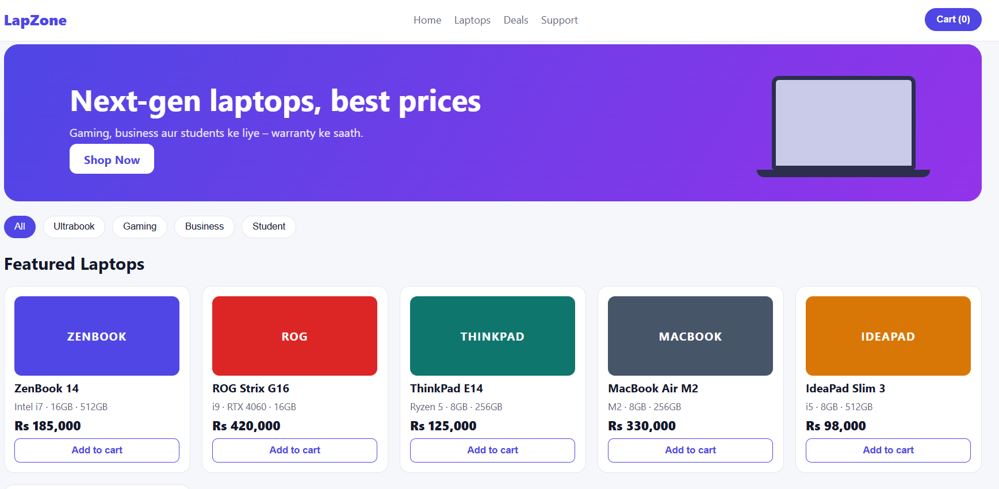

# LapZone: Containerized Laptop Store

> **Application Containerization & Asset Optimization**
> A modular, reliable multi-container web application built with multi-stage Dockerfiles, secure environment configuration, and explicit container port routing, with CI/CD through GitHub Actions.

## Live Output

The application running in Docker on an AWS EC2 instance (port 8080):



---

## Objective

Build a modular, reliable application container environment package.

| Requirement | How it is implemented |
|---|---|
| Multi-stage Dockerfiles for a multi-dependency stack | `api/Dockerfile` and `frontend/Dockerfile` use separate build and runtime stages |
| Minimize final image footprint | Alpine base images, production-only dependencies, `.dockerignore`, layer ordering |
| Secure environment variable mapping | `.env` file (git-ignored), `.env.example` template, GitHub Secrets for CI |
| Functional container port routing | Only Nginx is published (`8080:80`); the API, DB and cache live on a private network |

## Architecture

```
Browser ──► Nginx :8080 (frontend) ──/api──► Node.js API :3000 ──► PostgreSQL :5432
                                                               └──► Redis :6379
```

| Service | Image / Runtime | Port (container) | Exposed to host |
|---|---|---|---|
| `frontend` | Nginx 1.27 Alpine | 80 | Yes, `8080` |
| `api` | Node.js 20 Alpine | 3000 | No |
| `db` | PostgreSQL 16 Alpine | 5432 | No |
| `cache` | Redis 7 Alpine | 6379 | No |

Two Docker networks are used: `front` (frontend and api) and `back` (api, db and cache; `internal: true`, so it is isolated from the outside).

## Project Structure

```
lapzone/
├── .github/workflows/docker.yml   # CI: build and push images to GHCR
├── frontend/
│   ├── Dockerfile                 # multi-stage: minify, then Nginx
│   ├── nginx.conf                 # static serving and /api proxy
│   └── index.html                 # laptop store UI
├── api/
│   ├── Dockerfile                 # multi-stage: deps, then runtime
│   ├── .dockerignore
│   ├── package.json
│   └── server.js                  # Express API (Postgres + Redis)
├── docs/screenshot.png
├── docker-compose.yml
├── .env.example                   # committed template
├── .gitignore
└── README.md
```

## Implementation Guide

### 1. API service (`api/server.js`)

Express server with `/health` and `/api/products`. Products are read from PostgreSQL and cached in Redis for 60 seconds.

```js
const express = require("express"), { Pool } = require("pg"), redis = require("redis");
const app = express();
const db = new Pool({ host: process.env.DB_HOST, user: process.env.DB_USER,
  password: process.env.DB_PASSWORD, database: process.env.DB_NAME });
const cache = redis.createClient({ url: process.env.REDIS_URL });
cache.connect();
app.get("/health", (_, r) => r.send("ok"));
app.get("/api/products", async (_, res) => {
  const hit = await cache.get("products");
  if (hit) return res.json(JSON.parse(hit));
  const { rows } = await db.query("SELECT * FROM products");
  await cache.setEx("products", 60, JSON.stringify(rows));
  res.json(rows);
});
app.listen(3000);
```

### 2. API Dockerfile (multi-stage)

```dockerfile
# Stage 1: production dependencies only
FROM node:20-alpine AS deps
WORKDIR /app
COPY package*.json ./
RUN npm ci --omit=dev && npm cache clean --force

# Stage 2: minimal runtime
FROM node:20-alpine AS runtime
ENV NODE_ENV=production
WORKDIR /app
COPY --from=deps /app/node_modules ./node_modules
COPY server.js ./
USER node
EXPOSE 3000
HEALTHCHECK CMD wget -qO- http://localhost:3000/health || exit 1
CMD ["node","server.js"]
```

`api/.dockerignore`:
```
node_modules
.env
.git
*.log
```

### 3. Frontend Dockerfile (multi-stage)

```dockerfile
# Stage 1: build / minify static assets
FROM node:20-alpine AS build
WORKDIR /src
COPY index.html .
RUN npm i -g html-minifier-terser && \
    html-minifier-terser --collapse-whitespace --minify-js --minify-css \
    -o index.min.html index.html

# Stage 2: Nginx serves only the final files
FROM nginx:1.27-alpine
COPY nginx.conf /etc/nginx/conf.d/default.conf
COPY --from=build /src/index.min.html /usr/share/nginx/html/index.html
EXPOSE 80
```

`frontend/nginx.conf`:
```nginx
server {
  listen 80;
  root /usr/share/nginx/html;
  location / { try_files $uri /index.html; }
  location /api/ { proxy_pass http://api:3000; }
  gzip on;
}
```

### 4. Secure environment configuration

`.env.example` (committed):
```
DB_USER=lapzone
DB_PASSWORD=change_me
DB_NAME=lapzone
```

```bash
cp .env.example .env     # then set real values
```

- `.env` is listed in `.gitignore` and `.dockerignore`.
- Secrets are never baked into the image with `ENV` or `ARG`.
- In CI, secrets are stored in **GitHub, Settings, Secrets and variables, Actions**.

### 5. Docker Compose (`docker-compose.yml`)

```yaml
services:
  frontend:
    build: ./frontend
    ports: ["8080:80"]
    depends_on: [api]
    networks: [front]
  api:
    build: ./api
    env_file: .env
    environment:
      DB_HOST: db
      REDIS_URL: redis://cache:6379
    depends_on:
      db: { condition: service_healthy }
      cache: { condition: service_started }
    networks: [front, back]
  db:
    image: postgres:16-alpine
    environment:
      POSTGRES_USER: ${DB_USER}
      POSTGRES_PASSWORD: ${DB_PASSWORD}
      POSTGRES_DB: ${DB_NAME}
    volumes: [pgdata:/var/lib/postgresql/data]
    healthcheck:
      test: ["CMD-SHELL","pg_isready -U ${DB_USER}"]
      interval: 5s
      retries: 5
    networks: [back]
  cache:
    image: redis:7-alpine
    networks: [back]
networks:
  front: {}
  back: { internal: true }
volumes:
  pgdata:
```

### 6. Run locally or on a server

```bash
git clone https://github.com/<USERNAME>/lapzone.git && cd lapzone
cp .env.example .env
docker compose up -d --build
docker compose ps
curl http://localhost:8080/api/products
```

Open `http://<server-ip>:8080`. On AWS EC2, allow inbound **TCP 8080** in the instance Security Group.

### 7. CI/CD with GitHub Actions

`.github/workflows/docker.yml`:

```yaml
name: Build & Push Docker Images
on:
  push:
    branches: [main]
  pull_request:
permissions:
  contents: read
  packages: write
jobs:
  build:
    runs-on: ubuntu-latest
    strategy:
      matrix:
        service: [api, frontend]
    steps:
      - uses: actions/checkout@v4
      - uses: docker/setup-buildx-action@v3
      - name: Login to GHCR
        if: github.event_name != 'pull_request'
        uses: docker/login-action@v3
        with:
          registry: ghcr.io
          username: ${{ github.actor }}
          password: ${{ secrets.GITHUB_TOKEN }}
      - uses: docker/build-push-action@v6
        with:
          context: ./${{ matrix.service }}
          push: ${{ github.event_name != 'pull_request' }}
          tags: |
            ghcr.io/${{ github.repository_owner }}/lapzone-${{ matrix.service }}:latest
            ghcr.io/${{ github.repository_owner }}/lapzone-${{ matrix.service }}:${{ github.sha }}
          cache-from: type=gha
          cache-to: type=gha,mode=max
```

Images are published to **GitHub Container Registry**:
`ghcr.io/<USERNAME>/lapzone-api` and `ghcr.io/<USERNAME>/lapzone-frontend`.

To deploy from the registry, replace `build:` with `image:` in Compose, then run `docker compose pull && docker compose up -d`.

## Image Optimization Summary

| Technique | Benefit |
|---|---|
| Multi-stage builds | Build tools and caches are excluded from final images |
| Alpine base images | Roughly 5 MB base instead of about 120 MB for Debian |
| `npm ci --omit=dev` | No dev dependencies in the runtime image |
| `.dockerignore` | Smaller build context, no secret leakage |
| Layer ordering (`package*.json` first) | Dependency layer is cached between builds |
| Non-root user and healthchecks | Safer and self-monitoring containers |

Verify sizes with:
```bash
docker images
docker history <image>
```

## Security Notes

- Secrets live in `.env` or GitHub Secrets, never in the repository or image layers.
- Only the frontend port is published; the database and cache are unreachable from outside.
- The API runs as a non-root user.
- CI uses the least-privilege `GITHUB_TOKEN`.

## Useful Commands

```bash
docker compose logs -f api     # follow API logs
docker compose down            # stop the stack
docker compose down -v         # stop and remove the DB volume
```

## Tech Stack

Docker, Docker Compose, Nginx, Node.js (Express), PostgreSQL, Redis, GitHub Actions, GitHub Container Registry, AWS EC2.

